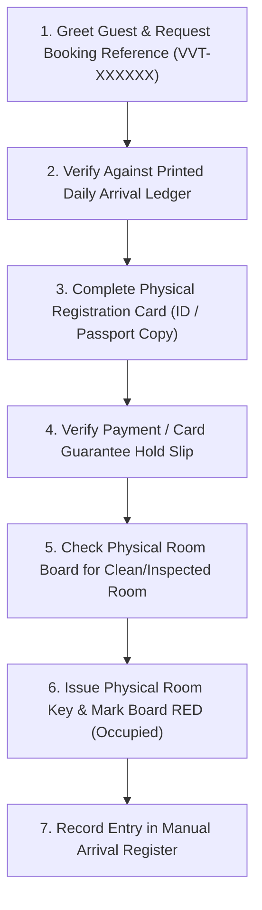
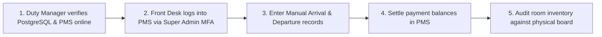

# VVotel Front Desk – Manual Offline Operating Procedure (SOP)

**Document Reference:** `SOP-OPS-001`  
**Target Property:** Vattanac Hotel (VVotel) Kampong Cham Riverside Resort & Spa  
**Target Audience:** Front Desk Agents, Duty Managers, Housekeeping Supervisors, Night Auditors  
**Operational Trigger:** Central PMS, Cloud Database, or Internet Network Interruption  

---

## 1. Operational Purpose & Activation Criteria

This Standard Operating Procedure (SOP) ensures zero disruption to arriving, staying, and departing hotel guests when electronic PMS systems or internet connectivity are unavailable.

> [!IMPORTANT]
> **Activation Protocol:**
> When the online PMS displays a connection error or fails to load for $> 3\text{ minutes}$, the Duty Manager activates the **Physical Emergency Front Desk Kit** located in the Front Office Safe.

---

## 2. Emergency Front Desk Kit Checklist
The Physical Emergency Kit contains:
1. **Printed Daily Expected Arrival Ledger** (Updated and printed every morning at 06:00 and 14:00 by the Front Desk Shift Lead).
2. **Physical Room Status Board / Visual Pin Board** (Color-coded: Green = Clean/Vacant, Red = Occupied, Yellow = Out of Service/Maintenance).
3. **Physical Manual Guest Registration Cards** (Bilingual Khmer / English).
4. **Offline Payment Terminal (POS Device)** & Paper Credit Card Imprinter / Pre-Auth Slips.
5. **Cash Receipt Ledger Book** (Official stamped triplicate receipts).
6. **Physical Room Key Cards / Master Emergency Keys**.

---

## 3. Step-by-Step Manual Workflow Procedures

### 3.1 Guest Check-In Procedure

1. **Arrival Verification:** Ask guest for their booking reference (`VVT-XXXXXX`) or full name. Locate their record in the **Printed Daily Arrival Ledger**.
2. **Identification:** Inspect national ID card or passport. Record ID number on the Physical Registration Card.
3. **Payment Verification:**
   - If marked `PAID` (Bakong KHQR or PayWay): Check bank slip copy or guest mobile banking receipt. Record reference code.
   - If marked `GUARANTEED` (Pre-Auth Hold): Process payment via standalone POS terminal or collect cash deposit. Issue stamped triplicate receipt.
4. **Room Allocation:** Check the visual room board for clean/inspected rooms. Assign room number and update physical pin to **RED (Occupied)**.
5. **Key Issuance:** Encode physical RFID room key using standalone desktop key programmer (or issue physical master key).

### 3.2 Walk-In Guest Procedure
1. Verify vacant room availability on the physical room board.
2. Quote authoritative published walk-in rate (Standard Superior \$125.00/night + Breakfast \$15.00/person).
3. Complete full registration card and collect 100% room charge plus a \$20.00 incidental deposit.
4. Record booking in the **Manual Walk-In Register** with prefix `WALK-IN-<date>-<room>`.

### 3.3 Guest Check-Out & Housekeeping Handover
1. Verify guest room number and collect physical keys.
2. Inspect room minibar / restaurant charge slips recorded in the guest's physical folio envelope.
3. Settle final balance (cash or POS card machine). Issue final stamped receipt.
4. Radio Housekeeping Supervisor immediately: *"Room [Number] is VACANT DIRTY."*
5. Move pin on the room board from **RED (Occupied)** to **ORANGE (Vacant Dirty)**.

---

## 4. Post-Recovery System Reconciliation (Data Catch-Up)

As soon as internet and PMS connectivity are restored:

1. **Reconciliation Sequence:**
   - Input all manual check-ins into the PMS using the exact check-in timestamps recorded on the paper registration cards.
   - Input all departures and finalize checkout in the PMS.
   - Enter any manual walk-in reservations to synchronize room inventory and prevent double-booking.
2. **Financial Balancing:**
   - Total physical cash collected and POS batch settlement slips.
   - Match totals against the PMS Daily Revenue Report.
3. **Sign-Off:**
   - Duty Manager and Night Auditor sign both the paper manual register and the digital audit log.
